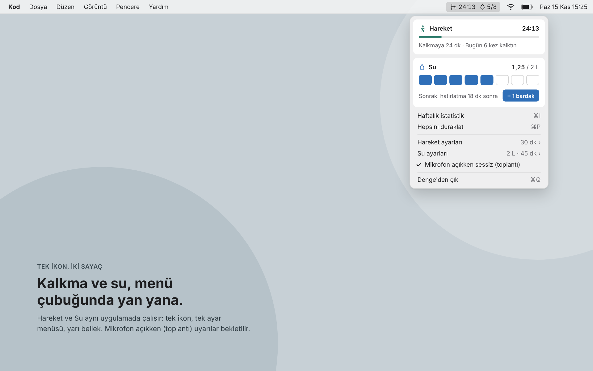
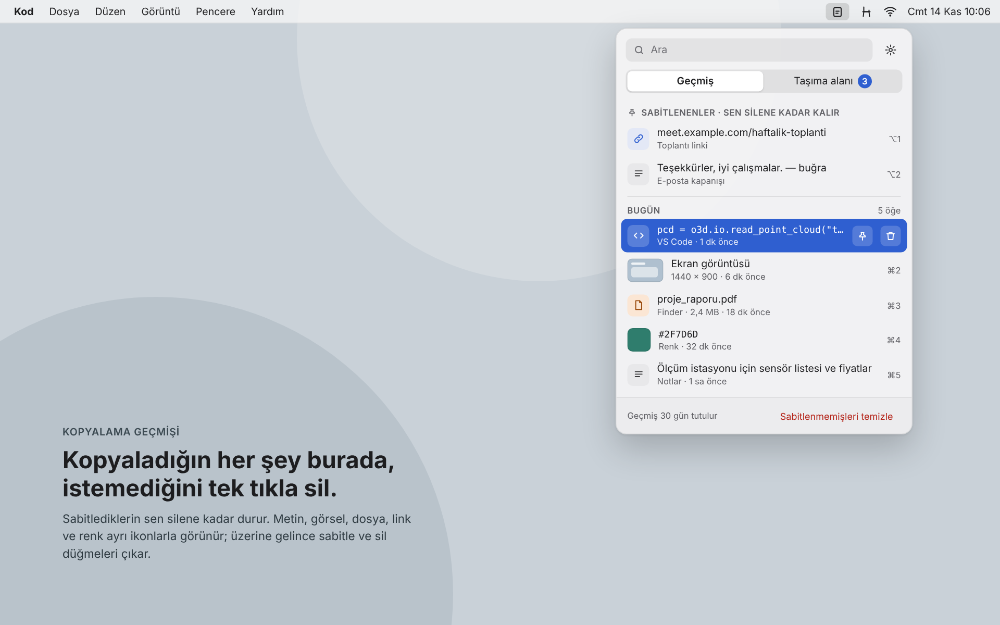
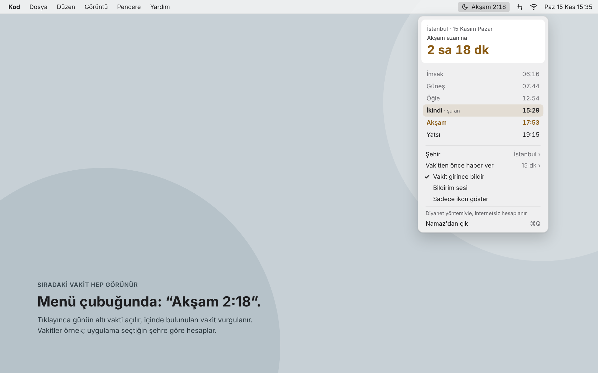
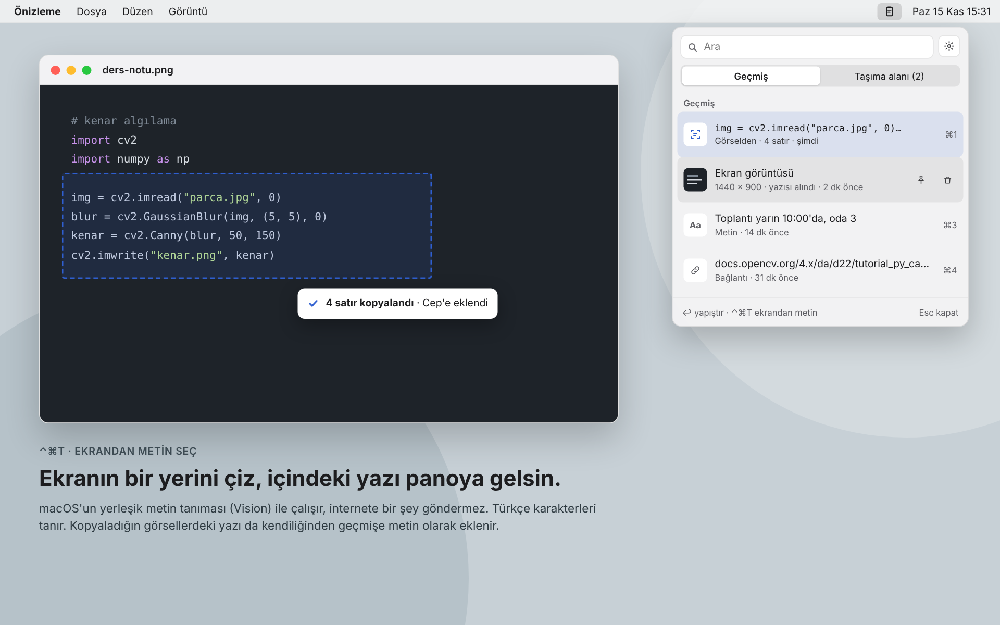

# mac-araclari

Mac menü çubuğu için üç küçük, Türkçe araç. Python ve macOS'un kendi arayüz
kütüphaneleriyle (PyObjC) yazıldı; her biri tek komutla `.app` olarak kurulur.

*Three small macOS menu bar utilities with a Turkish UI — English summary below.*

| | |
|---|---|
| **[Denge](denge/)** | Kalk ve su iç hatırlatıcısı. Uzun süre oturunca ve belirli aralıklarla su içmen için uyarır; ikisi denk gelirse tek uyarıda birleşir. Haftalık istatistik. |
| **[Cep](cep/)** | Kopyalama geçmişi ve taşıma alanı. Kopyaladıklarını arar, sabitler, silersin; görsellerdeki yazıyı da alır. Dosyaları menü çubuğundaki ikona sürükleyip istediğin klasöre taşırsın. |
| **[Namaz](namaz/)** | Menü çubuğunda sıradaki namaz vakti ve kalan süre, namaz takibi (kıldım işareti, haftalık tablo, vakit çıkmadan hatırlatma). Dünya genelinde 200+ şehir, ülkeye göre hesaplama yöntemi; internetsiz. |


<p align="center">
  
  
</p>
<p align="center">
  
  
</p>
<p align="center"><sub>Tasarım görselleri — gerçek uygulamada küçük farklar olabilir.</sub></p>

## Kurulum

```bash
git clone https://github.com/mustafabugraokurer/mac-araclari.git
cd mac-araclari/denge   # ya da: cep, namaz
./install.sh
```

Ya da klasördeki **`Kur.command`** dosyasına çift tıkla.

**Gereken:** macOS 12 veya üstü, Python 3.9+ ve Xcode Komut Satırı Araçları
(`xcode-select --install`).

Kurulum betiği uygulamayı senin Mac'inde derler, `~/Applications` klasörüne koyar,
oturum açınca başlatır ve çökerse yeniden açar. Uygulamalar Apple tarafından imzalı
olmadığı için hazır `.app` dağıtılmıyor; kaynak koddan derlemek bu yüzden en temiz yol.

Ayrıntılar her uygulamanın kendi README'sinde: [Denge](denge/README.md) ·
[Cep](cep/README.md) · [Namaz](namaz/README.md)

> Daha önce **Hareket** kurduysan: Denge onun yerini aldı. `denge/install.sh` eski
> uygulamayı kaldırır ve ayarlarını aktarır.

### Cep için izin

"Seçince yapıştır", `⌃⌘V` ve `⌃⌘T` kısayolları için bir kez **Erişilebilirlik** izni gerekir:
Sistem Ayarları → Gizlilik ve Güvenlik → Erişilebilirlik → Cep. Yeniden derledikten
sonra Cep'i listeden kaldırıp tekrar eklemen gerekebilir. `⌃⌘T` (ekrandan yazı) ayrıca
**Ekran Kaydı** izni ister.

## Gizlilik

Her şey senin Mac'inde kalır; uygulamalar internete bağlanmaz. Görsellerdeki yazı
da Mac'in kendi metin tanımasıyla, cihazda okunur. Cep'in geçmişi
`~/Library/Application Support/Cep/` içinde durur ve şifre yöneticilerinin "gizli"
olarak işaretlediği kopyaları kaydetmez.

---

## English

Three small menu bar utilities for macOS, written in Python with PyObjC. The UI is in Turkish.

- **Denge** ("balance") — a stand-up and water reminder in one app. When you have been
  sitting for 30 minutes, a dialog asks you to confirm you stood up (starting a short
  break) or to snooze; a separate timer reminds you to drink water. If both are due
  together, they merge into a single alert. Alerts wait while the microphone is in use,
  and a weekly chart shows your stand-ups and water intake. (Replaces the earlier *Hareket*.)
- **Cep** ("pocket") — clipboard history with search, pinning, deletion and a
  "frequently used" section, plus a file shelf: drag files onto the menu bar icon,
  then drag them out to any folder to move or copy them. Quick paste with `⌃⌘V`.
  Text in copied images is recognized on-device (Vision) and saved as text too;
  `⌃⌘T` lets you select a screen region and copy its text.
- **Namaz** ("prayer") — Islamic prayer times in the menu bar, computed offline for
  200+ cities worldwide with the recommended method per country (Diyanet, MWL, ISNA,
  Umm al-Qura, Karachi and more). Includes prayer tracking: mark prayers as done,
  see a weekly table and get a reminder before a prayer's time runs out.

**Install:** clone the repo, `cd` into an app folder and run `./install.sh`
(or double-click `Kur.command`). Requires macOS 12+, Python 3.9+ and the Xcode
Command Line Tools. The script builds the app locally with py2app, installs it to
`~/Applications`, and registers a LaunchAgent so it starts at login and restarts if
it crashes. Cep needs Accessibility permission for auto-paste and the hotkey.

Everything stays on your Mac; none of the apps make network requests.

## Lisans / License

[MIT](LICENSE)
