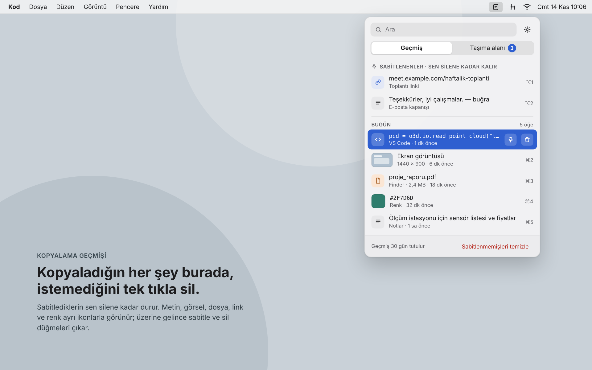
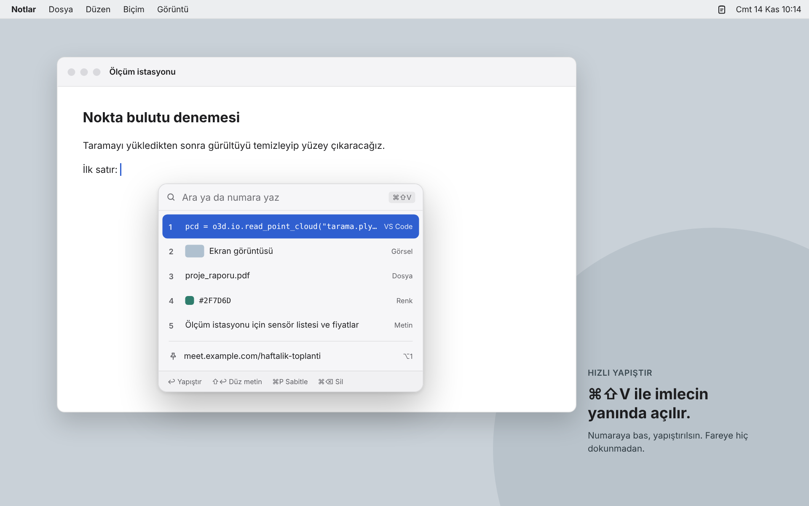
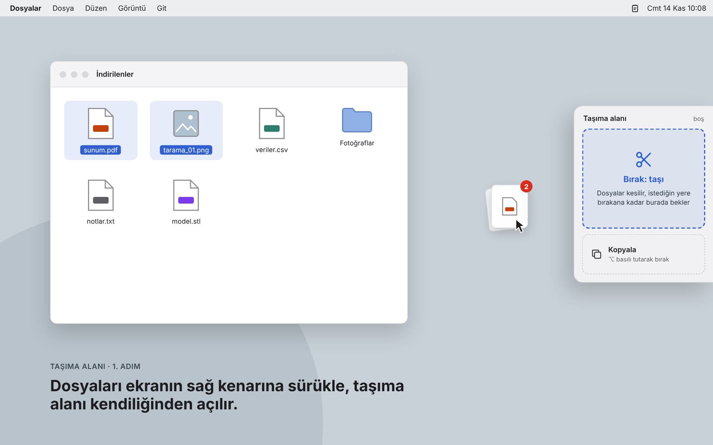
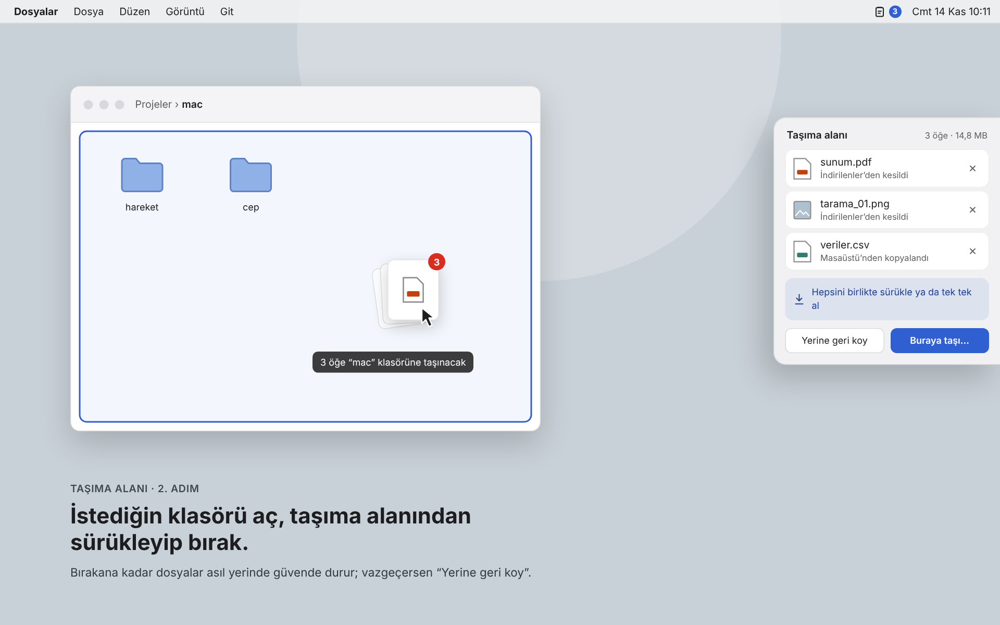

# Cep — Kopyalama geçmişi ve taşıma alanı

Menü çubuğunda pano ikonu durur.

<p align="center">
  
  
</p>
<p align="center">
  
  
</p>
<p align="center"><sub>Tasarım görselleri — gerçek uygulamada küçük farklar olabilir.</sub></p>

## Panel

Menü çubuğundaki pano ikonuna **tıkla** → panel açılır. **Sağ tık** → ayarlar.

- Üstte **arama**: yazdıkça geçmiş süzülür.
- **Geçmiş** sekmesi: Sabitlenenler · Sık kullanılanlar · Geçmiş
  - Satıra tıkla → kopyalar (ve "Seçince yapıştır" açıksa yapıştırır)
  - Satırın üzerine gel → **📌 sabitle** ve **🗑 sil** düğmeleri çıkar
  - **Sık kullanılanlar**: en az 2 kez yapıştırdığın öğeler kendiliğinden burada görünür
- **Taşıma alanı** sekmesi: dosyaları buraya sürükle-bırak, sonra istediğin klasöre sürükle
- Klavye: **↑↓** seç · **↩** yapıştır · **⌘1–9** hızlı seç · **⌘P** sabitle ·
  **⌘⌫** sil (arama boşken) · **Esc** kapat
- **Sabitlenenler sen silene kadar kalır.** Diğerleri 30 gün ya da 200 öğe tutulur.
- Şifre yöneticilerinin "gizli" işaretlediği kopyalar kaydedilmez.

## Hızlı yapıştır: ⌃⌘V (Control + Command + V)

Panel farenin olduğu yerde açılır. ↑↓ ve ↩ ya da ⌘1–9 ile seç, yapıştırılsın.
(⌘⇧V birçok uygulamada "biçimsiz yapıştır" olarak kullanıldığı için ⌃⌘V seçildi.)

## Taşıma alanı

1. Dosyaları **menü çubuğundaki Cep ikonuna** sürükle → taşıma alanı ikonun altında açılır. (Ekranın en sağ kenarına sürüklemek de çalışır.)
2. **Üst alana bırak = kes (taşı)**, alt alana ya da ⌥ ile bırak = kopyala.
3. İstediğin klasörü aç, dosyayı taşıma alanından oraya sürükle.
   Hepsini birden sürüklemek için **"Taşıma alanı" başlığından tut**.
4. Ya da **Buraya taşı…** ile klasör seç.

Dosyalar sen bırakana kadar **asıl yerinde durur**; Cep hiçbir dosyayı kendi başına silmez.
"Vazgeç" taşıma alanını boşaltır, dosyalara dokunmaz.
İkona sağ tıklayıp "Taşıma alanı"nı seçerek de açabilirsin.

## Kurulum

`Kur.command` dosyasına çift tıkla ya da klasörde Terminal'den:

```bash
./install.sh
```

Gereken: macOS 12+, Python 3.9+ ve Xcode Komut Satırı Araçları (`xcode-select --install`).

**Seçince yapıştır** için bir kez izin gerekir:
Sistem Ayarları → Gizlilik ve Güvenlik → **Erişilebilirlik** → Cep'i aç.
Yeniden kurduktan sonra çalışmazsa Cep'i listeden kaldırıp tekrar ekle.

Kaldırmak için: `./uninstall.sh`

## Dosyalar

- Geçmiş ve ayarlar: `~/Library/Application Support/Cep/`
- Günlük: `~/Library/Logs/Cep.log`
- Sorun olursa `Teshis.command`'a çift tıkla: son kayıtları `teshis.log` dosyasına yazar.
