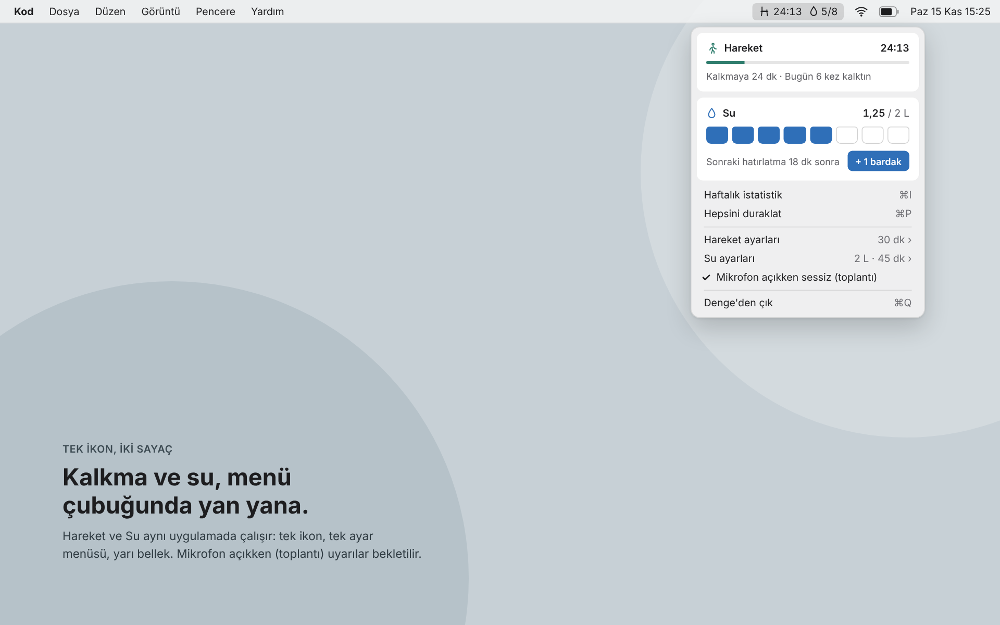
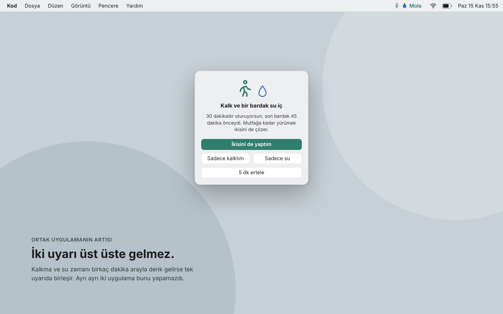
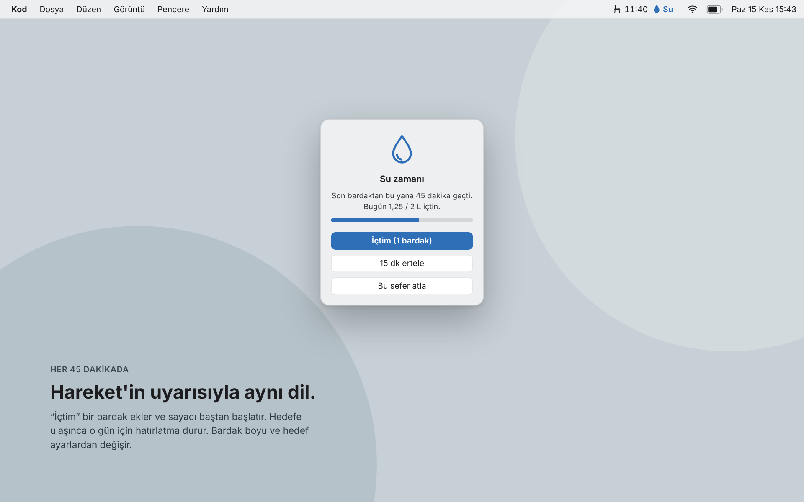
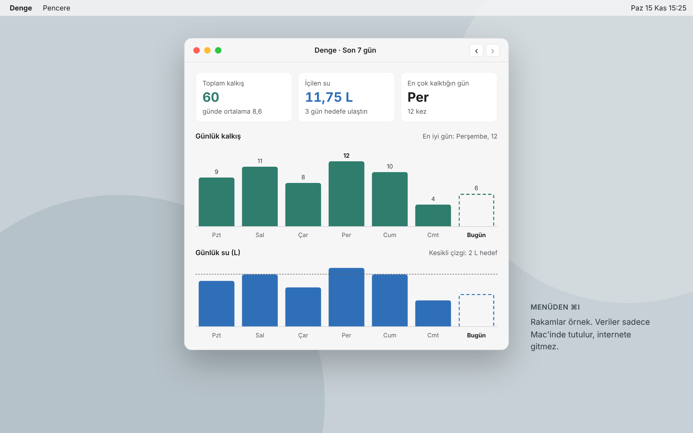

# Denge — Kalk ve su iç hatırlatıcısı

Hareket ve Su tek uygulamada. Menü çubuğunda sandalye ikonu, kalkmaya kalan süre
(`24 dk`) ve içtiğin bardak sayısı (`5/8`) yan yana durur.

<p align="center">
  
  
</p>
<p align="center">
  
  
</p>
<p align="center"><sub>Tasarım görselleri — gerçek uygulamada küçük farklar olabilir.</sub></p>

## Hareket

30 dakika oturunca ekranda uyarı açılır, sen seçersin:

- **Kalktım** → mola başlar (varsayılan 5 dk). Mola bitince **Başlat** demeden sayaç başlamaz.
- **5 dk ertele / 15 dk ertele**

"Bugün X kez kalktın" sadece **Kalktım** deyince artar. Bilgisayarı birkaç dakika
kullanmazsan (doğal mola) sayaç sessizce sıfırlanır; Mac uyuyup uyanınca da.

## Su

Bilgisayar başındayken her 45 dakikada bir hatırlatır:
**İçtim** (bir bardak ekler) · **15 dk ertele** · **Bu sefer atla**.
Günlük hedefe ulaşınca o gün için hatırlatma durur. Menüdeki **+ 1 bardak** düğmesi ya da
**⌘D** ile istediğin zaman ekleyebilirsin; yanlışlıkla eklediysen "Son bardağı geri al".

## İkisi birlikte

- Kalkma ve su zamanı 5 dakika arayla denk gelirse **tek uyarı** gelir:
  İkisini de yaptım · Sadece kalktım · Sadece su içtim · 5 dk ertele.
- **Mikrofon açıkken sessiz (toplantı):** mikrofon kullanılıyorsa uyarılar bekletilir
  (en fazla bir saat), toplantı bitince gelir.
- **Haftalık istatistik (⌘I):** son 7 günün kalkış ve su grafikleri.

## Kurulum

`Kur.command` dosyasına çift tıkla ya da klasörde Terminal'den:

```bash
./install.sh
```

Eski **Hareket** uygulaması kuruluysa betik onu durdurup Çöp Sepeti'ne taşır;
ayarların ve bugünkü kalkış sayın Denge'ye aktarılır.

Gereken: macOS 12+, Python 3.9+ ve Xcode Komut Satırı Araçları (`xcode-select --install`).
Kaldırmak için: `./uninstall.sh`

## Menü

- Hareket ve Su kartları, **Bir bardak içtim** (⌘D)
- **Haftalık istatistik** (⌘I), **Hepsini duraklat** (⌘P), **Kalktım, sıfırla** (⌘R)
- **Hareket ayarları:** hatırlatma süresi, mola süresi, doğal mola süresi
- **Su ayarları:** aç/kapat, günlük hedef (1,5–3 L), bardak (200–500 ml), aralık (30–90 dk)
- **Mikrofon açıkken sessiz**, **Bildirim sesi**, **Sadece ikon göster**, **Oturum açınca başlat**

## Dosyalar

- Ayarlar: `~/Library/Application Support/Denge/ayarlar.json`
- Gün gün kalkış ve su: `~/Library/Application Support/Denge/gunluk.json`
- Günlük: `~/Library/Logs/Denge.log`
