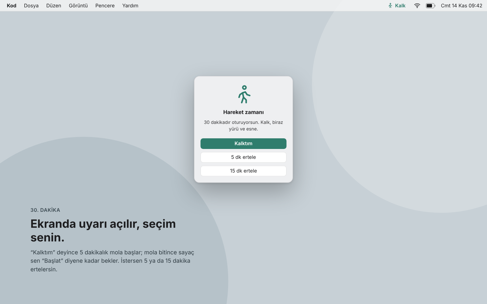
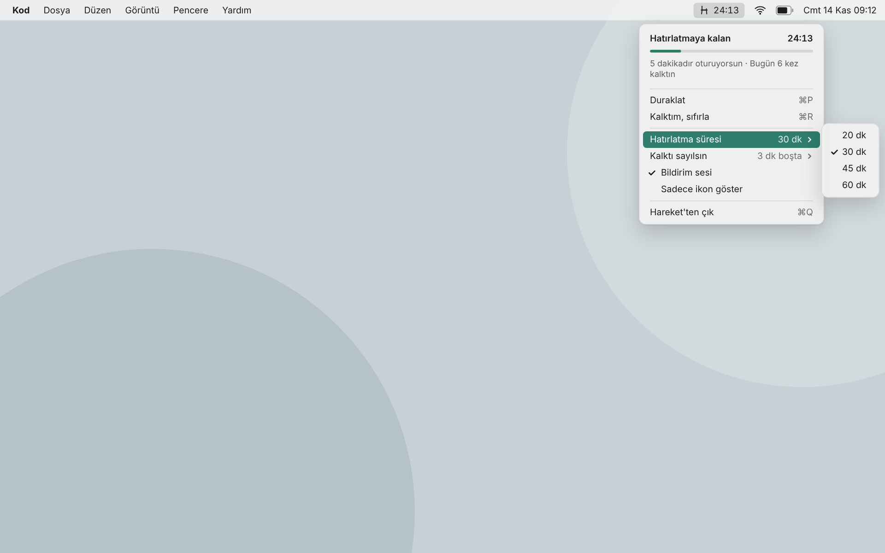
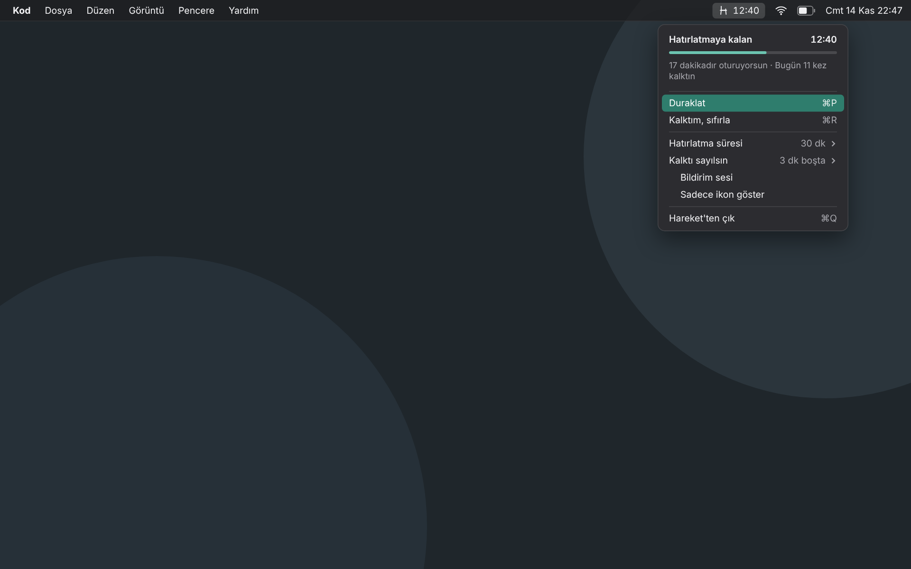
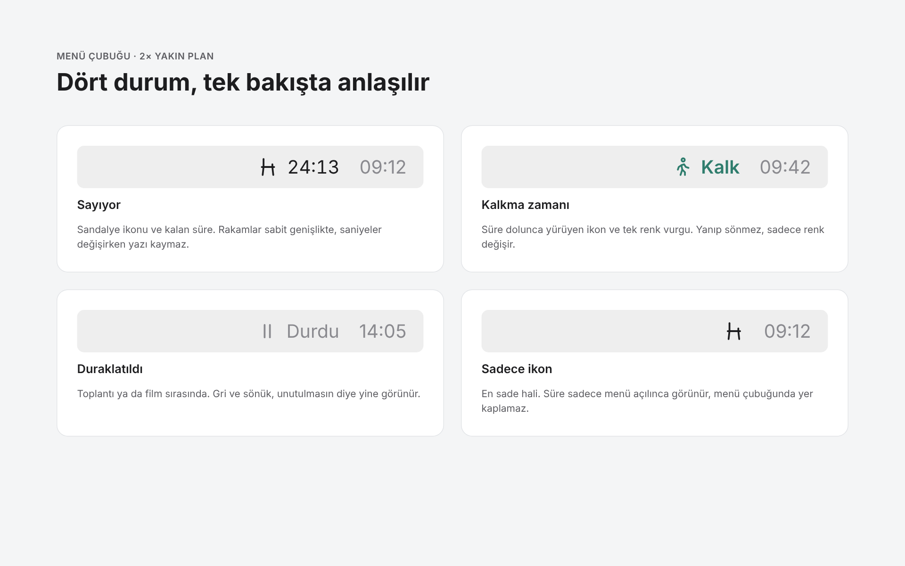

# Hareket — Menü çubuğu kalk hatırlatıcısı

Apple Watch'taki "kalk" uyarısının Mac'teki karşılığı. Menü çubuğunda sandalye ikonu ve
kalan süre (`24:13`) durur. Süre dolunca ekranda bir uyarı açılır, sen seçersin:

- **Kalktım** → mola başlar (varsayılan 5 dk), menü çubuğunda `Mola 04:59` görünür
- **5 dk ertele / 15 dk ertele** → sayaç ertelenir, süre dolunca uyarı tekrar gelir

Mola bitince tekrar sorar: **Başlat** ya da **5 dk daha mola**. Sen "Başlat" demeden
sayaç başlamaz. "Bugün X kez kalktın" sayısı sadece "Kalktım" deyince artar.

Bilgisayarı birkaç dakika kullanmazsan (doğal mola) sayaç sessizce sıfırlanır.
Mac uyuyup uyanınca da sıfırlanır.

<p align="center"></p>
<p align="center">
  
  
</p>
<p align="center"></p>
<p align="center"><sub>Tasarım görselleri — gerçek uygulamada küçük farklar olabilir.</sub></p>

## Kurulum

`Kur.command` dosyasına çift tıkla ya da klasörde Terminal'den:

```bash
./install.sh
```

Bu betik:
1. Ayrı bir Python ortamı (`.venv`) kurar, sistemine dokunmaz
2. `Hareket.app` uygulamasını ikonuyla derler ve `~/Applications` klasörüne koyar
3. **Oturum açınca kendiliğinden başlatır**
4. **Çökerse yeniden açar** (menüden "Hareket'ten çık" dersen kapalı kalır)

Gereken: macOS 12+, Python 3.9+ ve Xcode Komut Satırı Araçları (`xcode-select --install`).

## Menü

- **Hatırlatmaya kalan / Mola** – süre, ilerleme çubuğu, bugün kaç kez kalktığın
- **Duraklat / Devam et** (⌘P) – toplantı, film
- **Kalktım, sıfırla** (⌘R) – molayı elle başlatır; molada **Molayı bitir** olur
- **Hatırlatma süresi** – 20 / 30 / 45 / 60 dk
- **Mola süresi** – 2 / 5 / 10 dk
- **Kalktı sayılsın** – 2 / 3 / 5 dk boşta kalınca sayaç sıfırlansın
- **Bildirim sesi**, **Sadece ikon göster**, **Oturum açınca başlat**
- **Hareket'ten çık** (⌘Q)

## Güncelleme ve kaldırma

Kodu değiştirdikten sonra `./install.sh` komutunu tekrar çalıştır.
Kaldırmak için: `./uninstall.sh`

## Kurmadan deneme

```bash
python3 -m venv .venv && .venv/bin/pip install -r requirements.txt
.venv/bin/python hareket.py
```

## Dosyalar

- Ayarlar: `~/Library/Application Support/Hareket/ayarlar.json`
- Günlük: `~/Library/Logs/Hareket.log`
