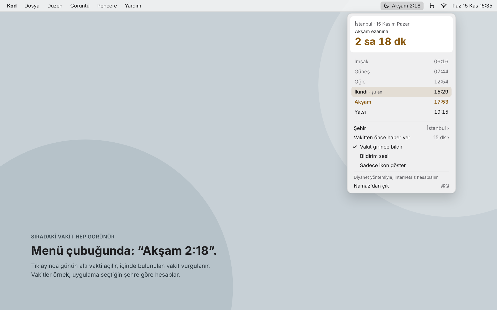
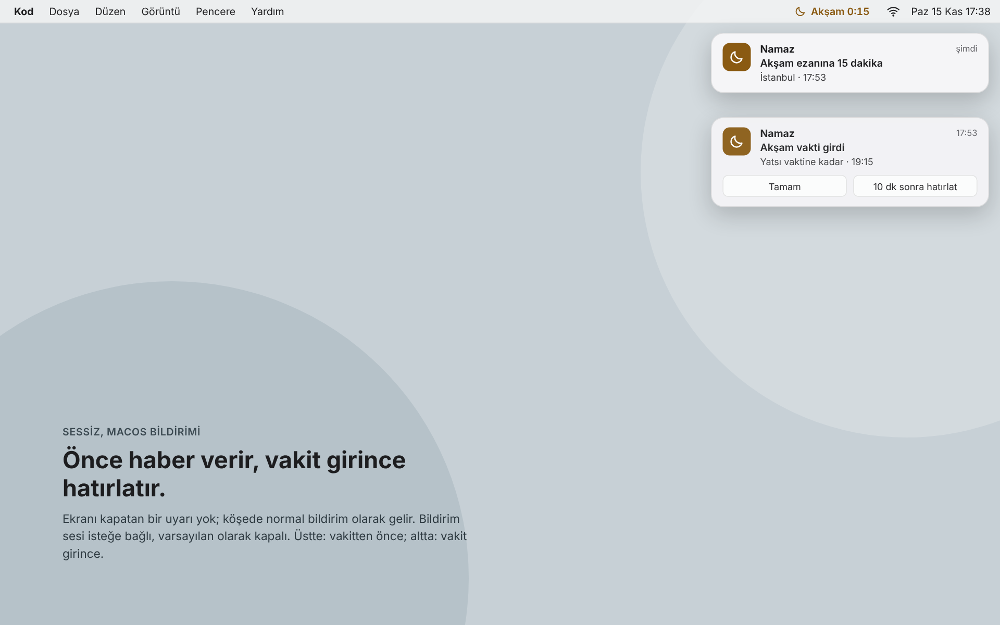

# Namaz — Menü çubuğunda namaz vakitleri ve namaz takibi

Menü çubuğunda sıradaki vakit ve kalan süre durur: `Akşam 2:18`. Tıklayınca günün altı
vakti açılır; içinde bulunduğun vakit kalın, sıradaki vurgulu görünür.

<p align="center">
  
  
</p>
<p align="center"><sub>Tasarım görselleri — gerçek uygulamada küçük farklar olabilir.</sub></p>

## Namaz takibi

- Kıldığın vakte menüden **tıkla**, yanına ✓ gelir (tekrar tıklayınca geri alınır).
  Gece yarısından sonra yatsıyı işaretlersen önceki güne yazılır.
- Menünün üstünde **"Bugün kılınan: 3/4"** görünür.
- **Haftalık takip (⌘T):** son 7 günün tablosu — hangi vakit kılındı, hangisi kılınmadı.
- **Kılınmadıysa vakit çıkmadan hatırlat:** işaretlemediğin bir namazın vakti çıkmadan
  15 / 30 / 45 / 60 dk önce bildirim (yatsı hariç; vakti imsakta çıkar).

## Bildirimler

- **Vakitten önce haber ver:** kapalı / 5 / 10 / 15 / 30 / 45 dk önce
- **Vakit girince bildir:** "Akşam vakti girdi · Yatsı vaktine kadar 19:15"
- Bildirimler köşede sessiz gelir; **Bildirim sesi** isteğe bağlı

## Dünya geneli

- **Konum:** Türkiye'nin 81 ili ve 59 ülkeden 130'u aşkın şehir (Avrupa, Balkanlar,
  Kafkasya, Orta Asya, Orta Doğu, Afrika, Güney ve Doğu Asya, Amerika, Avustralya).
  Vakitler o şehrin saat dilimine göre gösterilir.
- **Hesaplama yöntemi:** ülkeye göre önerilen yöntem kendiliğinden seçilir, istersen
  değiştirirsin: Diyanet, Müslüman Dünya Birliği, ISNA, Mısır, Ümmü'l-Kura, Karaçi,
  Körfez, Kuveyt, Katar, Singapur, Malezya, Endonezya, Fas, Fransa (UOIF), Rusya.
- **İkindi: Hanefi** — gölge boyu iki misli olduğunda (Pakistan, Hindistan, Orta Asya
  gibi ülkelerde varsayılan).
- Kutba yakın yerlerde (ör. Oslo yazın) güneş yeterince alçalmadığında imsak ve yatsı
  "açıya göre gece payı" kuralıyla hesaplanır.

## Vakitler nasıl hesaplanıyor?

İnternet gerekmez. Vakitler güneşin konumundan hesaplanır. Diyanet yönteminde imsak için
güneş ufkun 18°, yatsı için 17° altında; ikindi için gölge boyu bir kat. Diyanet
çizelgeleriyle aynı sonucu vermesi için temkin süreleri eklenir (güneş −7, öğle +5,
ikindi +4, akşam +7 dk).

Diyanet'in yayınladığı Türkiye çizelgeleriyle karşılaştırınca vakitler genelde aynı, bazen
**1 dakika** farklı çıkar. Diğer ülkelerde yerel takvimlerle birkaç dakika fark olabilir;
kesin vakit için o ülkenin resmî takvimi esastır.

## Kurulum

`Kur.command` dosyasına çift tıkla ya da klasörde Terminal'den:

```bash
./install.sh
```

Gereken: macOS 12+, Python 3.9+ ve Xcode Komut Satırı Araçları (`xcode-select --install`).
Kaldırmak için: `./uninstall.sh`

## Dosyalar

- `vakit.py` — vakit hesabı ve yöntemler (macOS'a bağımlı değil, tek başına denenebilir)
- `sehirler.py` — ülkeler, şehirler, saat dilimleri ve önerilen yöntemler
- Ayarlar: `~/Library/Application Support/Namaz/ayarlar.json`
- Takip: `~/Library/Application Support/Namaz/takip.json`
- Günlük: `~/Library/Logs/Namaz.log`
